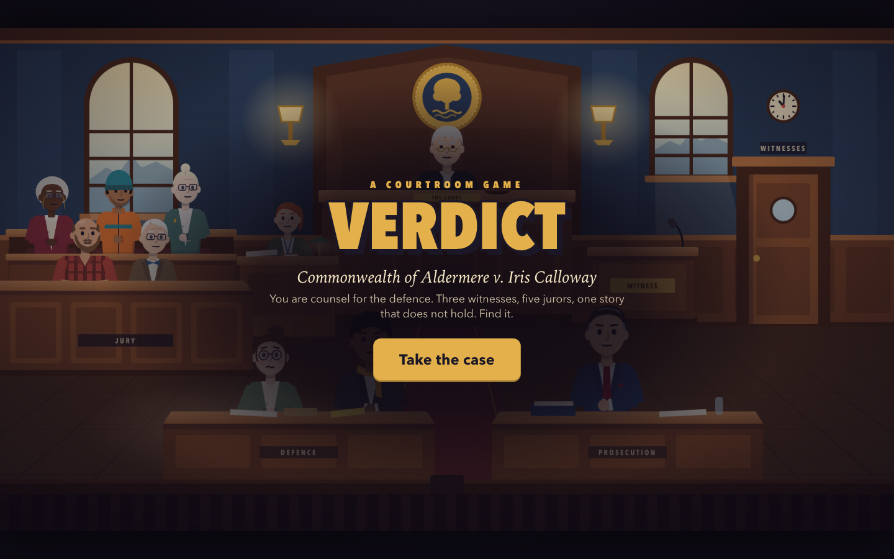
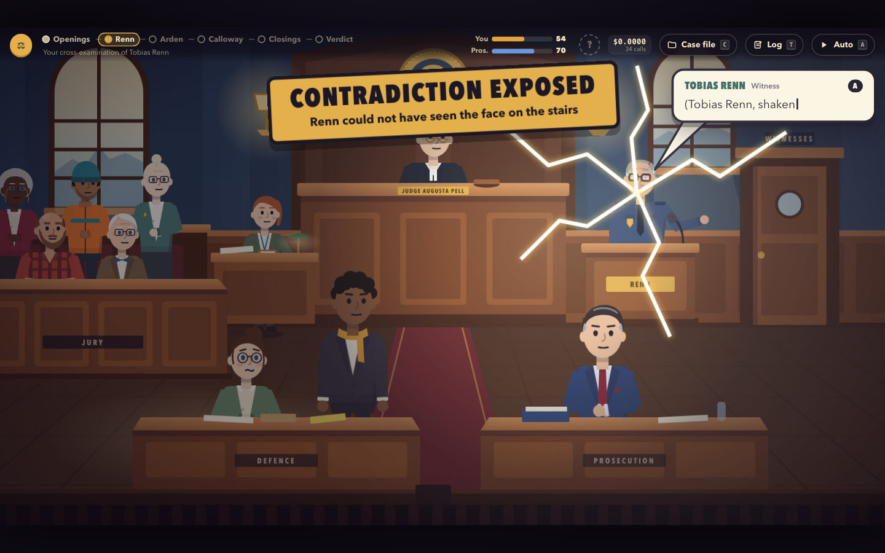
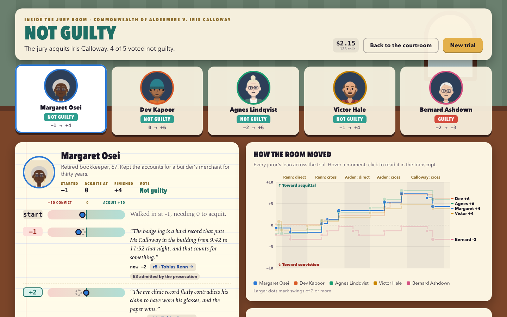
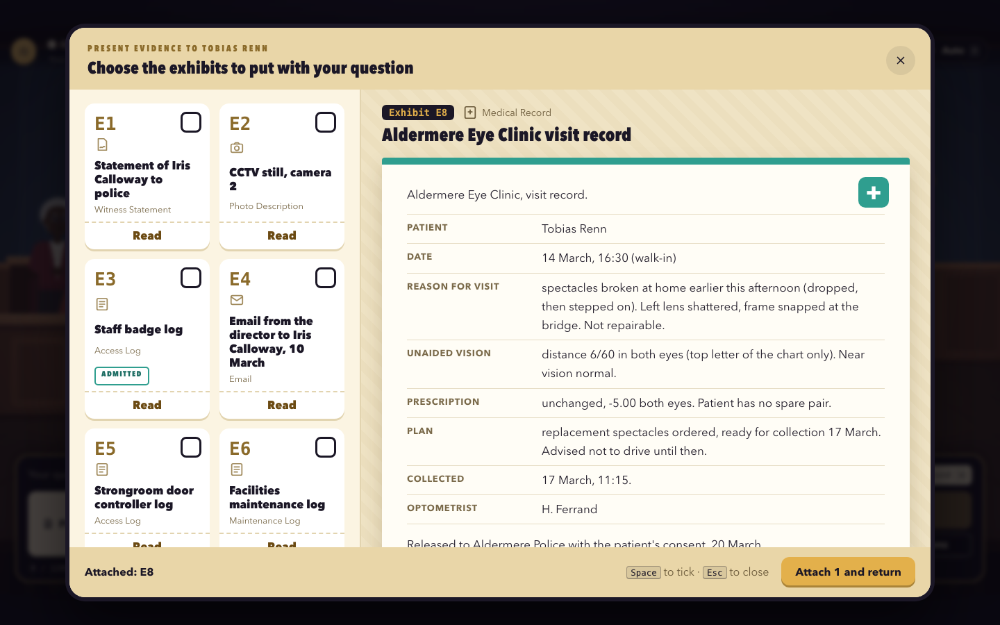

# Verdict

A courtroom game where you are the defence lawyer and everyone else in the room is played by AI.

You get one trial, about fifteen minutes long. You read the case file, give your opening, cross-examine the prosecution's witnesses, defend your client on the stand, and close. You type, or speak, whatever you want to say. Then five jurors decide, and you get to see exactly what changed each of their minds.

## The case

**Commonwealth of Aldermere v. Iris Calloway.** The Halvorsen sapphire has vanished from a museum strongroom and a night guard has been shoved down a stairwell. The prosecution says a conservator named Iris Calloway did both. Their case rests on a guard who swears he saw her face and a director who swears she was the only one with the code.

Somebody in that courtroom is lying. The documents in your case file can prove it, if you can find which one to put in front of which witness.

## What makes it different

**Cross-examination is the game.** Witnesses hide things. They hold their story under pressure, bluffing and insults, and they only break when you confront them with the exhibit that actually contradicts them. Waving a document around is not enough; you have to put the contradiction to them.

**Bluffing does not work.** Every statement you make is checked against the record. Invent a confession or a second witness and the prosecutor objects, the judge strikes your question, and your credibility with the jury drops. The prosecutor is held to the same rules.

**You object live.** When the prosecutor questions a witness, you decide in the moment whether to object, and on what ground: relevance, hearsay, leading, speculation, assuming facts not in evidence, or badgering. The judge rules against the written rules of the court. A good objection strikes the question. A bad one costs you.

**A jury of people, not a score.** Five jurors, each with their own temperament: one trusts paper records, one distrusts institutions, one reads character, one cannot stand lawyers who overreach, one defers to authority. Each has a private lean that shifts through the trial, and they do not all care about the same things.

**The deliberation replay.** After the verdict you go inside the jury room. For every juror you see where they started, each moment that moved them, by how much, and why, in their own words, linked back to the line of testimony that did it.

**The truth is fixed.** The case is hand-written with one hidden account of what really happened. Nothing is improvised to suit the player, so the trial is winnable on the evidence and it is the same puzzle for everyone.

## How it plays

- **A 2D courtroom.** An illustrated stage with the judge at the bench, the witness stand, the jury box and both counsel tables. Witnesses walk in when called and leave when excused. Your client sits beside you until it is her turn on the stand.
- **Speech bubbles and voices.** Dialogue plays one beat at a time in bubbles above whoever is speaking, and each character has their own voice.
- **Speak your questions.** Hold to talk and your words land in the question box, ready to edit before you ask.
- **The case file.** A binder you can open at any moment: the brief, ten exhibits styled as the documents they are, witness statements, the rules of the court, and the jurors.
- **Present evidence.** Attach exhibits to a question to put them to the witness and into the record.
- **Courtroom drama.** Objections cut across the room, the gavel comes down on rulings, and a witness caught in a lie visibly cracks.
- **A full transcript.** Everything said, struck or flagged is in the log, including which of your own claims the court found unsupported.

## Under the hood

The trial is run by code, not by a language model. The phase, the record, the evidence admitted, each witness's story and every juror's lean are tracked by the game itself. AI performs the characters and makes narrow, checkable judgements (is this claim in the record, does this question break a rule, did this question really confront the witness), and the game decides what happens next. A witness cannot be talked into confessing, because the performer is not given the truth until the evidence has earned it.
