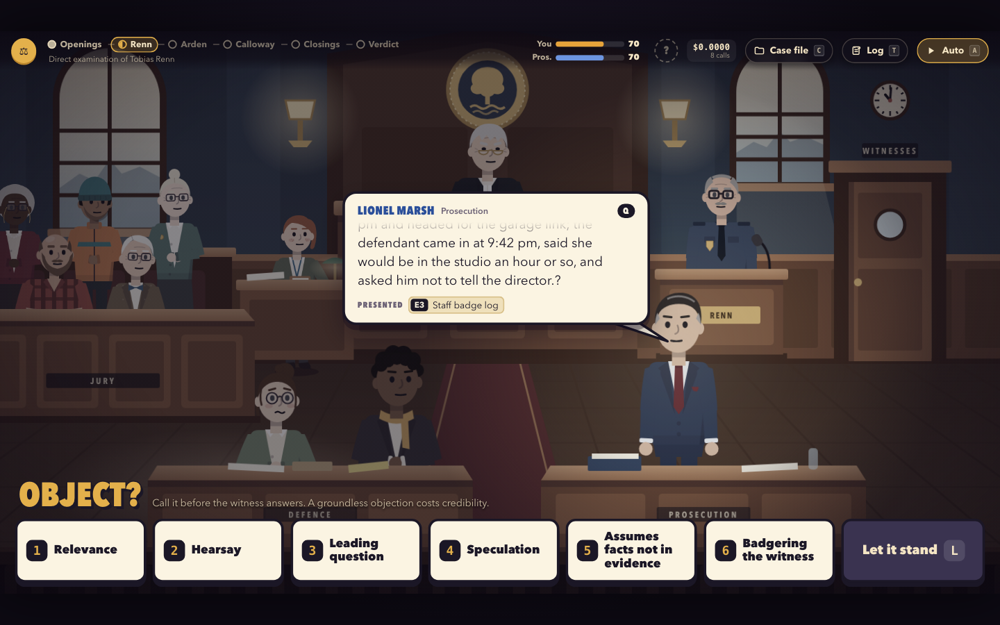

# Verdict

A courtroom game where you are the defence lawyer and everyone else in the room is played by AI.

You get one trial, about fifteen minutes long. You read the case file, give your opening, cross-examine the prosecution's witnesses, defend your client on the stand, and close. You type, or speak, whatever you want to say. Then five jurors decide, and you get to see exactly what changed each of their minds.

## The case

**Commonwealth of Aldermere v. Iris Calloway.** The Halvorsen sapphire has vanished from a museum strongroom and a night guard has been shoved down a stairwell. The prosecution says a conservator named Iris Calloway did both. Their case rests on a guard who swears he saw her face and a director who swears she was the only one with the code.

Somebody in that courtroom is lying. The documents in your case file can prove it, if you can find which one to put in front of which witness.

## What makes it different

**Cross-examination is the game.** Witnesses hide things. They hold their story under pressure, bluffing and insults, and they only break when you confront them with the exhibit that actually contradicts them. Waving a document around is not enough; you have to put the contradiction to them.

**Bluffing does not work.** Every statement you make is checked against the record. Invent a confession or a second witness and the prosecutor objects, the judge strikes your question, and your credibility with the jury drops. The prosecutor is held to the same rules.

**You object live.** When the prosecutor questions a witness, you decide in the moment whether to object, and on what ground: relevance, hearsay, leading, speculation, assuming facts not in evidence, or badgering. The judge rules against the written rules of the court. A good objection strikes the question. A bad one costs you.

**A jury of people, not a score.** Five jurors, each with their own temperament: one trusts paper records, one distrusts institutions, one reads character, one cannot stand lawyers who overreach, one defers to authority. Each has a private lean that shifts through the trial, and they do not all care about the same things.

**The deliberation replay.** After the verdict you go inside the jury room. For every juror you see where they started, each moment that moved them, by how much, and why, in their own words, linked back to the line of testimony that did it.

**The truth is fixed.** The case is hand-written with one hidden account of what really happened. Nothing is improvised to suit the player, so the trial is winnable on the evidence and it is the same puzzle for everyone.

## How it plays

- **A 2D courtroom.** An illustrated stage with the judge at the bench, the witness stand, the jury box and both counsel tables. Witnesses walk in when called and leave when excused. Your client sits beside you until it is her turn on the stand.
- **Speech bubbles and voices.** Dialogue plays one beat at a time in bubbles above whoever is speaking, and each character has their own voice.
- **Speak your questions.** Hold to talk and your words land in the question box, ready to edit before you ask.
- **The case file.** A binder you can open at any moment: the brief, ten exhibits styled as the documents they are, witness statements, the rules of the court, and the jurors.
- **Present evidence.** Attach exhibits to a question to put them to the witness and into the record.
- **Courtroom drama.** Objections cut across the room, the gavel comes down on rulings, and a witness caught in a lie visibly cracks.
- **A full transcript.** Everything said, struck or flagged is in the log, including which of your own claims the court found unsupported.

## How a trial runs

1. **Case file review.** You read the brief, ten exhibits, the witnesses' prior statements, the rules of the court and the jurors' backgrounds. Nothing is on the clock yet.
2. **Opening statements.** The prosecutor, Lionel Marsh, opens. Then you do. An opening may preview any exhibit in the file.
3. **Tobias Renn, night guard.** The prosecutor examines him, four questions, and you may object to each. Then he is yours for up to eight questions.
4. **Celeste Arden, museum director.** The same again: the prosecutor's direct examination, then your cross.
5. **Iris Calloway, your client.** She takes the stand and the prosecutor cross-examines her, six questions. You cannot question her yourself; you defend her with objections.
6. **Closing arguments.** The prosecutor closes, and you get the last word.
7. **Verdict.** The jurors vote one by one.
8. **Deliberation replay.** You go into the jury room and see what moved each of them.

## The rules of the court

Aldermere is a fictional jurisdiction. Its rules are short, written down in the case file, and applied by Judge Augusta Pell to both sides.

### Objections

| Ground | The rule | Example of a question that breaks it |
|---|---|---|
| **Relevance** | Questions must bear on the events of 14 and 15 March, the people involved, or a witness's reliability. | "What do you think of the museum's new café?" |
| **Hearsay** | A witness may not repeat what someone else told them in order to prove it true. They may say what they saw, heard and did, and what the defendant said to them. Exhibits are not hearsay. | "What did the other guards tell you about Ms Calloway?" |
| **Leading** | On direct examination a lawyer may not ask a question that suggests its own answer. On cross-examination leading questions are allowed. | On direct: "You saw the defendant's face clearly, didn't you?" |
| **Speculation** | A witness may not be asked to guess about things they did not see or cannot know, including what someone else was thinking. | "Why do you suppose the director raised the insurance?" |
| **Assumes facts not in evidence** | A question may not take for granted a fact that is not in the record or the agreed facts. | "After you took the sapphire, where did you hide it?" |
| **Badgering** | A lawyer may not argue with, insult or harass a witness, or keep repeating a question already answered. | "Come on, you're lying, aren't you? Aren't you?" |

An objection is decided only on the ground you raise. A question with a real flaw, objected to on the wrong ground, stands.

### Evidence

- Only the exhibits in the case file exist. Nobody may refer to any other document, recording or object as though it did.
- An exhibit enters the record when a lawyer presents it to a witness during questioning.
- Opening statements may preview any exhibit in the case file.
- Closing arguments may rely only on exhibits that have entered the record, testimony given in court, and the agreed facts.
- A lawyer may not assert as fact anything that is not in the record. A witness may be asked about it; a lawyer may not claim it.

## How you win

### Catching a lie

Each prosecution witness is hiding two things. A lie breaks only when both of these are true:

- you have presented the exhibit that contradicts it to that witness, and
- your question actually puts the contradiction to them.

Attach the right document and ask about something else, and nothing happens. Accuse them of lying without the document, and they deny it. When a lie does break, the witness concedes as little as they can get away with, the contradiction is stamped on your scoreboard, and the jury takes note.

The prosecutor plays by the same rule. Your client is holding back something of her own, and he has the paper to prove it.

### Credibility

Both lawyers start with a credibility of 70 out of 100, shown at the top of the screen. You lose it by:

| What happened | Cost |
|---|---|
| An objection you raised is overruled | 8 |
| Your question is struck after a sustained objection | 5 |
| You state something the record does not support | 6 |
| You state something the record contradicts | 10 |

Below 40, the jury stops giving you full credit: anything that would have moved a juror your way moves them half as far.

### The jury

Each juror carries a lean from -10 (certain to convict) to +10 (certain to acquit). It starts where their background puts them and moves by at most two points per exchange.

| Juror | Background |
|---|---|
| **Margaret Osei** | Retired bookkeeper, 67. Kept the accounts for a builder's merchant for thirty years. |
| **Dev Kapoor** | Delivery rider, 29. Works nights and has had his share of run-ins with management. |
| **Agnes Lindqvist** | Retired head teacher, 61. Spent thirty years working out who was telling the truth. |
| **Victor Hale** | Runs a small plumbing firm, 48. Likes people who get to the point. |
| **Bernard Ashdown** | Retired civil servant, 70. Thirty-five years at the Land Registry. |

What moves them:

- **A witness caught lying** moves every juror against the side that called that witness, some more than others.
- **A lawyer caught asserting something unsupported** costs that lawyer with the jurors who care about honesty.
- **Objections and rulings** matter only to jurors who care about procedure.
- **New evidence that bears directly on guilt** can shift a juror it matters to.
- **A lawyer conceding their own case** moves everyone, hard.
- **Rhetoric, confidence, repetition and emotion** move nobody.

You never see the leans during the trial. The jurors watch whoever is speaking and give nothing away.

### The verdict

Each juror has their own threshold for acquittal and votes not guilty if their final lean reaches it. Four of five votes decide the case either way. Anything closer is a hung jury.

## How it works

**The game keeps the facts.** The phase of the trial, the record, which exhibits are in, which lies still stand, both credibility meters and all five leans are tracked by code. No language model decides what is true or what happens next.

**Performers and referees are separate.** Every AI call is one of two kinds:

- *Performers* speak in character: the witnesses, the prosecutor and the judge's rulings from the bench. Each is given a persona and only what that character would know. Their words stream to you as they are written.
- *Referees* never speak. They return small structured judgements that the game checks before acting on them:
  - **The fact-checker** tags each claim in a statement or question as supported, unsupported or contradicted by the record.
  - **The rule-checker** tests a question against the six objection rules.
  - **The judge's ruling** decides a raised objection against the written rule.
  - **The confrontation check** decides whether a question really put the contradiction to the witness.
  - **The jury** returns each juror's reaction to the latest exchange, with a one-line reason.

**A witness cannot be talked into confessing.** While a lie stands, the performer playing that witness is given only the cover story. The true account is released to them at the moment the game marks the lie as broken, and not before. Pressure has nothing to extract.

**Jurors react to events, not to talk.** The jury referee is handed a list of what the game has established in the exchange (a lie broken, a claim flagged, an objection sustained) and may not infer anything else. That is why a confident bluff leaves the jury unmoved, and why the same transcript scores the same way when it is replayed.

**Both sides go through the same referees.** The prosecutor's statements are fact-checked, his questions can be struck, and his credibility falls by the same amounts as yours.

**One hand-written case.** The case is a single structured file: the true timeline, the exhibits, and for each witness what they know, what they lie about and what breaks each lie. It is the same puzzle for every player.

